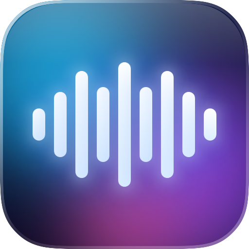
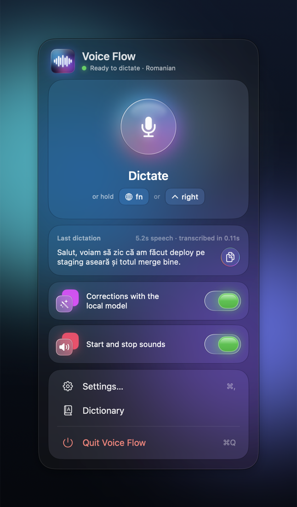
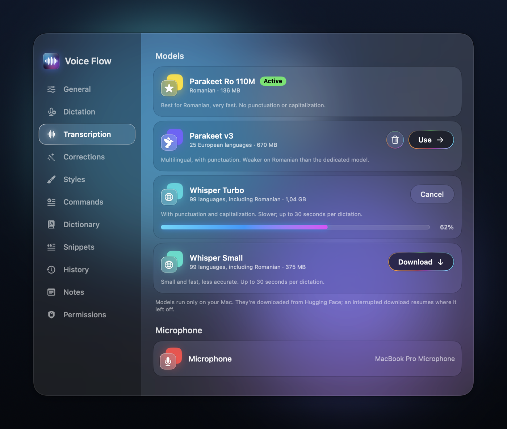

<p align="center">
  
</p>

<h1 align="center">Voice Flow</h1>

<p align="center">Local, private dictation for macOS: hold a key, speak, and the text appears at the cursor.</p>

<p align="center">
  
  &nbsp;
  
</p>

## What it is

Voice Flow is a dictation app for macOS. You hold a key, speak, release the key, and the transcribed text is
pasted wherever the cursor is, in any app. Speech recognition, the optional text corrections and all your data
stay on your Mac.

It is an open-source alternative in the spirit of Wispr Flow, built from two parts:

- a **Rust engine** (`crates/`, the `voice-flow` binary) that records, transcribes, corrects and pastes;
- a **SwiftUI app** (`macos/`) with the menu bar icon, the main window and the recording pill, which runs the
  engine as `voice-flow daemon` and talks to it over JSON lines.

Romanian is a first-class language here: besides the multilingual Parakeet and Whisper models, Voice Flow
supports a dedicated Romanian model (Parakeet Ro 110M), and the correction prompts were tuned on Romanian
dictation. Dictation in other languages works with the multilingual models.

## Features

- **Dictation at the cursor.** Three ways to record: hold the key while you speak, press once to start and once
  more to stop, or double-tap the key to lock recording hands-free. Esc cancels a recording. The default keys
  are Fn and the right Command key; you can record your own shortcut.
- **Model manager.** Download, select and delete speech models from the app: Parakeet (Romanian, multilingual
  v3, English v2) and Whisper (Turbo, Small).
- **Corrections with a local LLM.** An optional step that fixes punctuation, removes fillers and applies
  self-corrections. Voice Flow starts and stops `mlx_lm.server` by itself with the model you choose.
- **Correction levels and per-app styles.** Three levels (light, medium, strong) decide how much the text may
  change. Styles adapt the result to the app you dictate into: Messages, Email, Code (pasted as transcribed,
  without the LLM) and Default. The instruction of each style is editable.
- **Command Mode.** Select text, hold a second shortcut and say what you want ("make it shorter", "translate
  it to English"); the selection is replaced with the result from the local LLM.
- **Snippets.** Say a trigger phrase and a saved text is inserted instead.
- **Personal dictionary.** Names and technical terms the speech model should listen for, plus the misheard
  variants to replace automatically.
- **History and statistics.** Searchable history of your dictations with a configurable retention period,
  and usage statistics.
- **Notes.** A notes section inside the app.

## Requirements

- An Apple Silicon Mac.
- macOS 14 or later. The Liquid Glass look is used on macOS 26 and later.
- To build: the Rust toolchain (`cargo`) and the Xcode Command Line Tools (`swift`). Building with the Liquid
  Glass look needs Xcode 26.
- Optional, for corrections and Command Mode: `mlx-lm` (`uv tool install mlx-lm`), which provides
  `mlx_lm.server`.

## Install

Download `Voice Flow <version>.dmg` from the Releases page, open it and drag Voice Flow to Applications.

The app is not notarized by Apple (it is signed with a self-signed certificate), so macOS blocks it the first
time. To open it: try to open the app once, then go to System Settings > Privacy & Security, scroll to the
message about Voice Flow and click **Open Anyway**. You only need to do this once.

On first launch no speech model is installed: open **Transcription** and download one (Parakeet Ro for
Romanian, Parakeet v3 or Whisper for other languages). Then grant the two permissions described below.

## Build from source

From the repository root:

```bash
./scripts/build-app.sh --install
```

This builds the Rust engine and the SwiftUI app, packages them as `build/Voice Flow.app`, copies the app to
`~/Applications` and starts it. Without `--install` it only builds `build/Voice Flow.app`.

On the first build, `sherpa-onnx-sys` downloads its prebuilt macOS libraries from GitHub; they are linked
statically, so nothing else needs to be installed.

**The local signing certificate.** The build signs the app with a self-signed certificate that
`scripts/signing.sh` creates automatically on the first build and keeps in
`~/Library/Application Support/VoiceFlow/signing/`, in its own keychain. It exists for one reason: macOS ties
the Accessibility permission to the app's signing identity. With an ad-hoc signature every rebuild looks like a
new app and the permission stops working; with a stable local certificate you grant it once. The certificate
is not trusted for anything else and is not meant for distribution. If you delete the `signing` folder, a new
certificate is created and the permissions have to be granted again.

To make a disk image after building:

```bash
./scripts/make-dmg.sh
```

It creates `build/Voice Flow <version>.dmg` with the app and a shortcut to Applications.

## Permissions

On first launch macOS asks for two permissions for *Voice Flow*:

- **Microphone**, to record your voice.
- **Accessibility**, to listen for the global shortcut and to paste the text into the app you are using.

Both are granted in System Settings > Privacy & Security. Where exactly the Accessibility list lives depends
on the macOS version (on macOS 27 it is under "Device Control and Data Access"), so use the permission buttons
inside Voice Flow: they open the right place. The engine restarts by itself once Accessibility is granted.

If Accessibility shows as enabled but the app still reports it missing (a stale entry from an older
signature), reset it with `tccutil reset Accessibility <bundle id>` (the bundle identifier is in
`macos/Info.plist`) and grant it again.

If you use the Fn key as the shortcut, set System Settings > Keyboard > "Press 🌐 key to" to "Do Nothing";
otherwise Fn also opens the emoji picker or Apple's dictation.

## Models

Speech models are managed in the app: download, select and delete them from the model list.

| Model | Languages | Size | Notes |
|---|---|---|---|
| Parakeet Ro 110M | Romanian | ~130 MB | default; best for Romanian, no punctuation or capitalization |
| Parakeet v3 | 25 European languages | ~670 MB | with punctuation |
| Parakeet v2 | English | ~660 MB | |
| Whisper Turbo | 99 languages | ~1 GB | with punctuation; up to 30 s per dictation |
| Whisper Small | 99 languages | ~375 MB | faster, less accurate; up to 30 s per dictation |

Models are downloaded from Hugging Face into `models_dir` (set in `config.toml`); an interrupted download
resumes where it stopped. The Whisper language is `whisper_language = "ro"` in `config.toml` (empty = automatic
detection). The catalog lives in `crates/domain/src/models.rs`.

**The Romanian model.** Parakeet Ro 110M is an ONNX export (TDT branch, int8) of the Apache-2.0 SpeD Parakeet
Ro 110M model (`gabrielpirlo/SpeD_ParakeetRo_110M_TDT-CTC` on Hugging Face). The exported files are published at
`cristimihailax/parakeet-ro-110m-tdt-onnx` and the app downloads them from there like any other model. The
export itself is reproducible with `scripts/export-parakeet-ro.py` (it needs NVIDIA NeMo).

## Corrections

In the Corrections section you choose (or download) an LLM and turn corrections on. Voice Flow starts
`mlx_lm.server` with the chosen model and stops it when you turn corrections off or quit the app; the server
is tied to the app's process, so it also stops if the app dies. The server log is
`~/Library/Logs/VoiceFlowLLM.log`.

- You need `mlx_lm.server` (`uv tool install mlx-lm`).
- If a server you started yourself (Ollama, LM Studio, ...) already answers on the port in `cleanup.url`,
  Voice Flow uses that one and does not start another. `cleanup.manage_server = false` in `config.toml`
  disables the automatic start.
- Models downloaded from the app are stored in `models_dir/llm/`. MLX text models found in the Hugging Face
  cache are listed and can be used, but are never deleted by the app.
- If the server does not answer, the uncorrected text is pasted.

The correction level controls how much the model may change:

| Level | What it does |
|---|---|
| Light | punctuation, capitalization and diacritics only; no word is removed or moved |
| Medium | also removes fillers and involuntary repetitions and fixes dictionary terms |
| Strong | also applies self-corrections (only the final version is kept) and turns spoken enumerations into lists and long text into paragraphs |

The model keeps the language you spoke; it does not translate and does not answer questions or follow
instructions found in the dictated text. The base prompt, the style instructions and the Command Mode prompt
can be edited in the app.

## Dictionary

The dictionary is edited in the app (search, add, edit, delete, groups). The app changes only the line you
touch; comments and group titles (`# Tech`) stay as you wrote them, and a `dictionary.txt.bak` copy is made
before the first edit. The file can also be edited by hand.

`dictionary.txt`, one term per line:

```
# Tech
NestJS | esges, nes ges, nest js
deploy | de ploi, diploi
Lanzadera
```

The form before `|` is the correct one: it is sent to the speech model as a hotword (the model listens for
it) and given to the corrections step. The comma-separated variants after `|` are replaced automatically with
the correct form. A comment line directly above a term is a group title. Do not list ordinary words as
variants, or they will be replaced everywhere. Restart the engine after editing the file by hand.

## Where data is stored

| What | Where |
|---|---|
| Settings | `~/Library/Application Support/VoiceFlow/config.toml` |
| Dictation history | `~/Library/Application Support/VoiceFlow/history.jsonl` |
| Snippets | `~/Library/Application Support/VoiceFlow/snippets.json` |
| Notes | `~/Library/Application Support/VoiceFlow/notes/` |
| Local signing certificate | `~/Library/Application Support/VoiceFlow/signing/` |
| Speech and LLM models | `models_dir` from `config.toml` (LLMs in `models_dir/llm/`) |
| Dictionary | `dictionary_path` from `config.toml` |
| Engine log | `~/Library/Logs/VoiceFlow.log` |
| LLM server log | `~/Library/Logs/VoiceFlowLLM.log` |

By default both live next to `config.toml`: `~/Library/Application Support/VoiceFlow/models/` and
`~/Library/Application Support/VoiceFlow/dictionary.txt`. An example dictionary is in
`docs/dictionary.example.txt`.

## Privacy

Everything stays on your Mac: audio, transcripts, history, notes, snippets and the dictionary. There is no
telemetry and no cloud service. The only network access is downloading models from Hugging Face when you ask
for it (and, when building from source, the build tools fetching their dependencies).

## Development

The engine is a Cargo workspace:

```
crates/
  domain/                 pure types and logic: settings, dictionary, model catalog, styles, prompts, snippets, history
  application/            the dictation flow (record -> transcribe -> dictionary -> corrections) and Command Mode flow
  adapters/asr-sherpa/    Parakeet and Whisper through sherpa-onnx, with hotwords
  adapters/audio-cpal/    microphone capture, resampling to 16 kHz
  adapters/hotkey/        global shortcut (handy-keys)
  adapters/output-paste/  clipboard + Cmd+V, restoring the previous clipboard text
  adapters/llm-openai/    corrections through a local OpenAI-compatible server
  presentation/           Slint UI for the standalone binary: recording pill and tray icon
  app/                    the voice-flow binary: CLI, daemon protocol, model and LLM management
macos/                    the SwiftUI app
scripts/                  build, signing, disk image, model export, test recordings
```

Verification:

```bash
cargo test --release
cargo clippy --release --all-targets      # no warnings
(cd macos && swift build -c release)      # no warnings
```

The engine also works on its own from the command line:

```bash
cargo build --release
./target/release/voice-flow                          # dictation with the recording pill and a tray icon
./target/release/voice-flow run --no-ui              # terminal only
./target/release/voice-flow run --hotkey ctrl+opt    # another key: ralt (right Option), f13, cmd+shift+space
./target/release/voice-flow run --toggle             # press once to start, once more to stop
./target/release/voice-flow run --no-paste           # only print the text
./target/release/voice-flow --engine parakeet-v3     # choose the speech model
./target/release/voice-flow --clean                  # corrections with the local LLM
./target/release/voice-flow --no-dictionary          # without the dictionary and hotwords
./target/release/voice-flow transcribe file.wav      # transcribe WAV files
./target/release/voice-flow bench test-audio/ro      # WER / CER on .wav files that have a .txt next to them
./target/release/voice-flow keys                     # debugging: print every key press
./target/release/voice-flow config                   # show the settings path and the current settings
./target/release/voice-flow config --init            # write the default settings file
```

When run this way, the Microphone and Accessibility permissions belong to the terminal app you run it from.
`VF_NO_MIC=1 ./target/release/voice-flow --config <test config> daemon` starts the engine without a
microphone, so you can send it JSON commands on stdin and read the events; always use a test `--config` with
temporary paths.

`AGENTS.md` describes the architecture, the daemon protocol and the conventions for adding a feature.

Known limitations:

- If the clipboard held an image or a file, it is not restored after pasting (only text is).
- The Romanian model outputs text without punctuation; basic formatting adds the capital letter and the final
  period, the rest comes from corrections.

## Acknowledgements

- Handy by cjpais, for the idea of a local, open dictation app and for the
  `handy-keys` crate used for global shortcuts.
- sherpa-onnx, which runs the Parakeet and Whisper models.
- The authors of the SpeD Parakeet Ro 110M model, for a strong Romanian speech model under Apache-2.0.
- mlx-lm, which serves the local LLM used for corrections.

## License

MIT. See [LICENSE](LICENSE).
